<p align="center">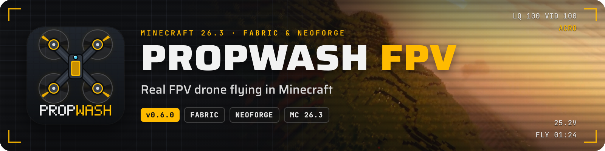</p>

**Real FPV drone flying in Minecraft.** Build a quadcopter from real-world parts, put on your goggles and fly it in
first person with your RC transmitter, a gamepad or the keyboard. Race through gates, freestyle over your builds or
just cruise the world from the air.

<p align="center">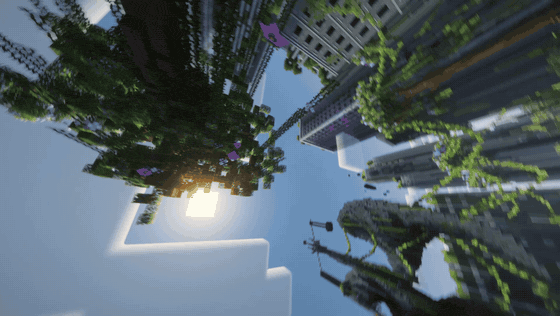</p>

Propwash has its own flight model and a Betaflight-style flight controller, so drones fly like the real thing: punchy
5″ freestylers, floaty whoops, efficient long-range cruisers. Everything works in survival, and an animated Flight
School teaches you the whole mod inside the game.

<p align="center">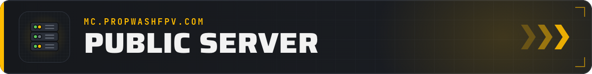</p>

<p align="center">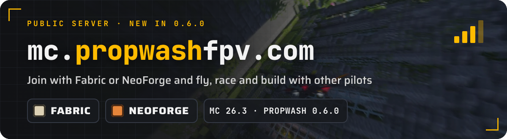</p>

Fly with other pilots on our public server **`mc.propwashfpv.com`**. New in 0.6.0: you can join with **Fabric or
NeoForge**. NeoForge players can join a Fabric server that runs the same Propwash version and add-ons. Install
Propwash 0.6.0 and add the address to your server list; if anything is missing, the join message names the mods.

<p align="center">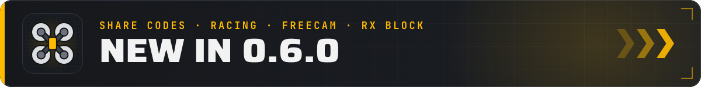</p>

- **Share codes for every add-on.** PW3 codes come from the workbench, the *Share code* tab or `/propwash code`. They name every add-on a build needs, show a shopping list in survival and are clickable in chat with a preview of the drone.
- **A bigger race system.** Loops and backwards passes, point-to-point courses, gates that snap into rows and dive cubes, a *Position* page, course IDs and a race standard for servers.
- **Every record comes with a replay.** Click a leaderboard time for the drone's share code, a first-person replay and a ghost to race.
- **Freecam drone.** A camera drone that exists only on your screen: no collision, no battery, straight through walls (`F6`, if the world allows it).
- **RX block.** Bind it to your radio and one channel becomes a redstone signal from 0 to 15, up to 128 blocks away.
- **Motor heat like on real quads.** The ESC throttles back when it overheats, hot motors lose power and wear out.
- **Clean battery mounts.** A plugged-in battery sits on the drone without plugs or leads, on every frame.
- **Drones react to blocks.** Slime bounces them back, wool and hay bales catch them, honey brakes and sticks, pressure plates and tripwires trigger.
- **Zones for everyone.** Every player can mark zones with the Zone Marker; creative barriers let only drones through or stop only drones.
- **Add-on API 1.8.** Add-ons can bring switches, OSD readouts, world rules, dispensing accessories, autonomous flights and a second pilot on the camera.

<p align="center">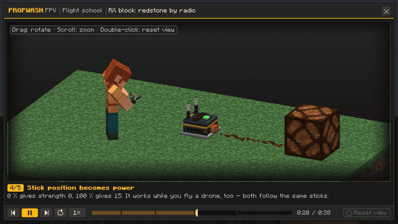</p>

<p align="center">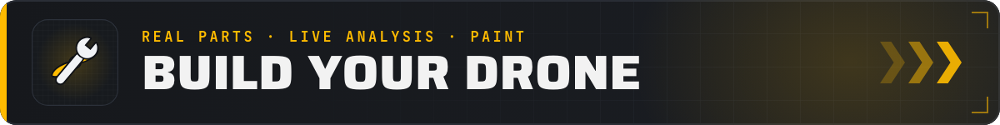</p>

<p align="center">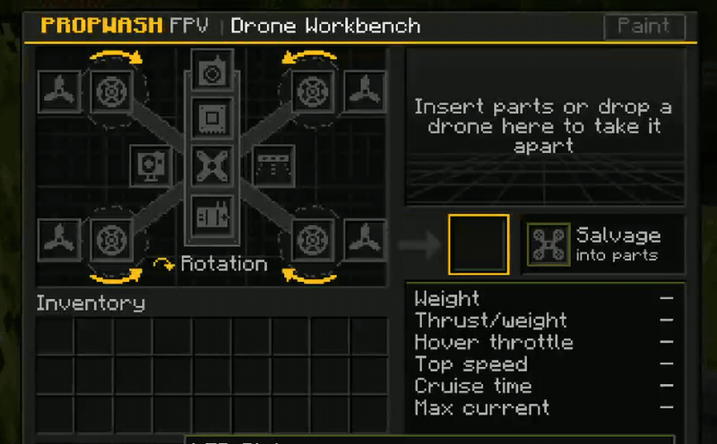</p>

- **Real parts, real numbers.** Five frames from a 65 mm whoop to a 7″ long range, with flight controllers, motors, props, batteries and video units that carry real specs. Weight, thrust, hover throttle, top speed and flight time follow from the build.
- **Drone Workbench.** A live 3D preview with thrust-to-weight, top speed and flight time, and a warning for every part that doesn't fit. Five ready-to-fly presets in creative.
- **Paint jobs.** Color twelve parts separately with dyes, carbon and metal finishes, hex colors and presets.
- **Crashes leave marks.** Props chip first, a hard hit puffs up the battery. Swap props in the field, repair them in pairs.

<p align="center">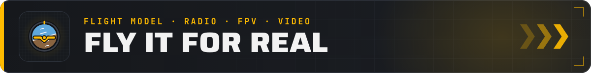</p>

- **A real flight model.** Rigid-body physics with motor, ESC and battery simulation, prop wash, ground effect, wind and gusts. Betaflight and Actual rates, PIDs, Acro, Angle and Horizon, 3D mode and GPS Rescue.
- **Your own radio.** EdgeTX/OpenTX over USB, gamepads or the keyboard. An animated receiver wizard sets it up, stick modes 1 to 4, every switch assignable.
- **FPV or line of sight.** Matching goggles put you behind the drone's camera with a Betaflight-style OSD (over 40 elements, drag-and-drop editor). Without goggles you fly line of sight.
- **Analog and digital video.** Analog breaks up in stages into snow and static, digital turns blocky and freezes. Walls dampen the link, hills, caves and deep water cut it.

<p align="center">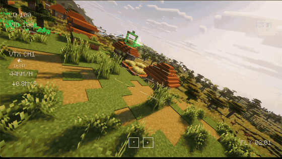</p>

<p align="center">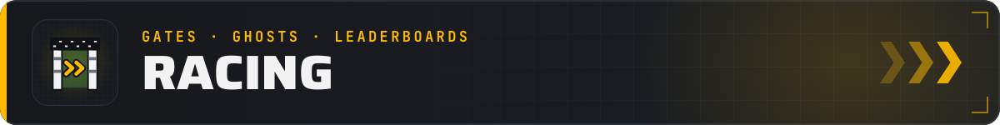</p>

<p align="center">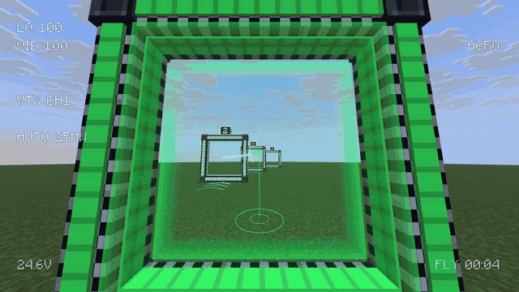</p>

- **Build your track.** Gates in three sizes, stacked ladders, gate poles, flags, slalom and dive cubes, freeform gates around any opening, turned freely in 45°, 15° or 5° steps.
- **Real race timing.** Splits at every gate, standing starts with start lights for several pilots, a glowing race line through the next gates.
- **Ghosts, replays, leaderboards.** Race your personal best or the server record per course and drone class. Only server-verified laps count.

<p align="center">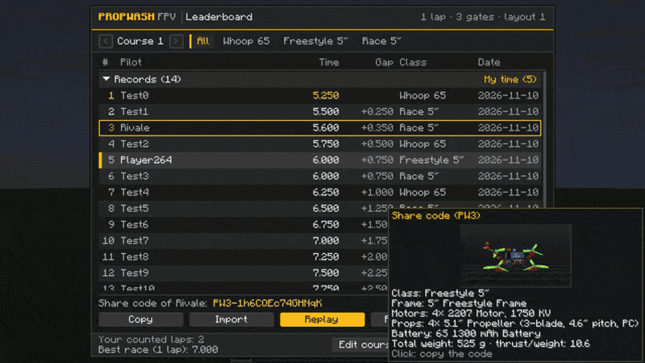</p>

<p align="center">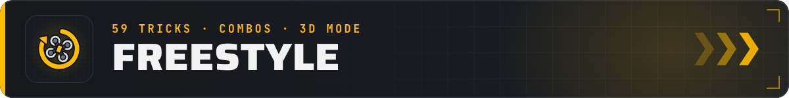</p>

<p align="center">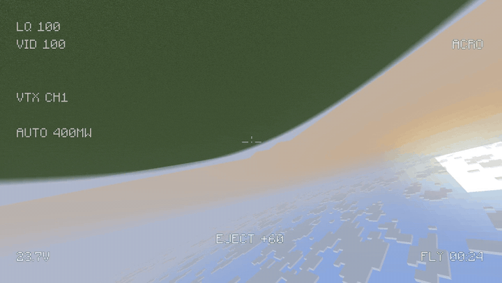</p>

**59 tricks in nine families** are recognized, even sloppy, fast or chained ones: flips and rolls, power loops, Juicy
Flicks, Matty flips, Sbang combos, Guillotines, Side Trippies and, in 3D mode, inverted flight and tic-tocs. Points,
combos up to ×4 and style bonuses show up in the OSD, and the *Freestyle* tab explains every trick.

<p align="center"></p>

<p align="center">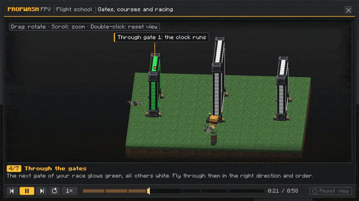</p>

**22 animated 3D lessons** explain everything with a small diorama, callouts and your own key bindings: building,
binding, FPV, racing, tricks, video systems, GPS Rescue and more. **Flight training** adds 20 lessons you fly yourself
through a holographic course, with stars, best times and splits. Hold **M** over any Propwash item to open its lesson.

<p align="center">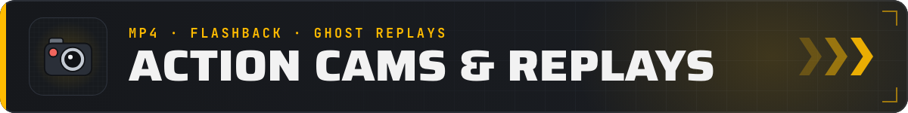</p>

- **Action cams that really record.** Mount one on the frame and record your flight as an MP4 (H.264, up to 1440p60, optional motor sound). The *Action Cam (Flashback)* turns each flight into a camera path for the replay mod Flashback.
- **Freecam drone.** Plan courses and film camera runs without risking a real drone.
- **LED strips and headlight.** 11 colors, Betaflight-style modes and a headlight that makes caves flyable in FPV; optional LambDynamicLights support.

<p align="center">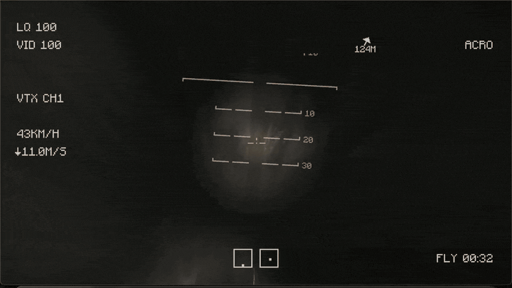</p>

<p align="center">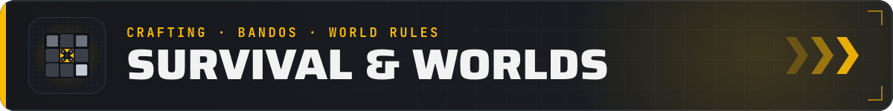</p>

- **Survival progression.** Everything except the creative goggles is craftable: a whole whoop from copper, iron and redstone, high-end parts with diamonds, amethyst and echo shards. Parts turn up in loot chests too.
- **Places to fly.** Rare bandos (barns, factories, water towers, piers, mine heads) and four kinds of ready-made race courses generate in the world.
- **World rules.** Gravity, battery life, wind, crash damage, range and more as game rules, with one-click presets *Realistic*, *Training* and *Arcade*.
- **Built for multiplayer.** The server streams chunks around the drone, checks movement and keeps the leaderboards honest.

<p align="center">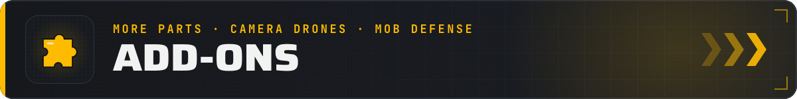</p>

Official add-ons for Propwash 0.6.0. Install them on the client **and** the server, in the same version.

<table><tr><td width="33%"><a href="https://modrinth.com/mod/propwash-just-more-parts">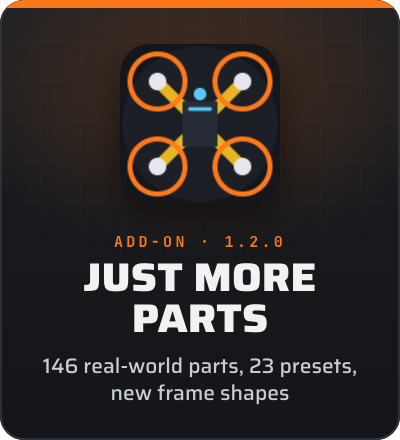</a></td><td width="33%"><a href="https://www.curseforge.com/minecraft/mc-mods/propwash-camera-drones">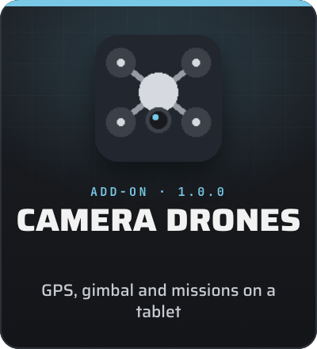</a></td><td width="33%"><a href="https://www.curseforge.com/minecraft/mc-mods/propwash-mob-defense">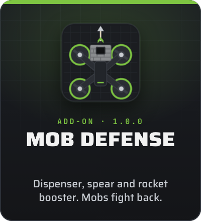</a></td></tr></table>

<p align="center">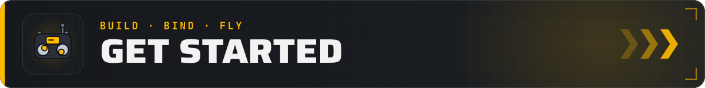</p>

1. Build a drone at the **Drone Workbench**, or grab a preset from the creative tab.
2. Place it on the ground and right-click it with the **FPV Remote** to bind it.
3. Put on **FPV goggles** that match its video system (analog or digital).
4. Hold the radio, right-click into the air, arm with your switch or **Z**, and fly.

Stuck? Hold **M** over any Propwash item for its Flight School lesson or **Shift** for a detailed tooltip. Full docs:
[propwashfpv.com/docs](https://propwashfpv.com/docs/).

<p align="center">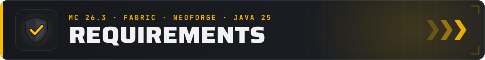</p>

- Minecraft **26.3** · Java 25
- **Fabric:** Fabric Loader 0.19.5+ and Fabric API · **NeoForge:** 26.3.0.10-beta or newer
- Required on the **client and the server**
- With *Just More Parts*: **1.2.0** or newer (1.1.x does not start with Propwash 0.6.0)
- Optional: [LambDynamicLights](https://modrinth.com/mod/lambdynamiclights) for LED strips as real light sources
- Radios in USB joystick mode. With a shader pack, the video effect falls back to a simpler overlay.

<p align="center">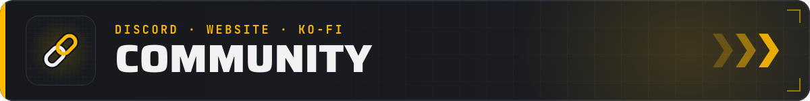</p>

<p align="center">

[](https://discord.gg/bNhkSXYSgZ) [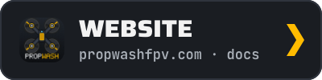](https://propwashfpv.com) [](https://ko-fi.com/propwashfpv)

</p>

Questions, builds, race times? Join the Discord or read the docs on the website. Propwash and its add-ons are free;
if you enjoy them, you can support the project on [Ko-fi](https://ko-fi.com/propwashfpv). Thank you!

## For add-on makers

Propwash has a public add-on API (`de.lardtom.propwash.api`, add-on API 1.8 in Propwash 0.6.0, MIT licensed) with an
example add-on. Start with [`ADDONS.md`](ADDONS.md) and the step-by-step guide
[`docs/api/addon-guide.md`](docs/api/addon-guide.md); what changed for add-ons in each release is in
[`docs/api/changes.md`](docs/api/changes.md).

**Reserved namespace.** The namespace `propwash` (registry ids, translation keys, key mappings, game rules, network
payloads, data and asset paths) and the Java package `de.lardtom.propwash` are reserved for Propwash. Add-ons must use
their own namespace. Resource packs and data packs may still override Propwash's existing assets and data. Guidelines
for add-ons (stable API, naming) are in [`ADDONS.md`](ADDONS.md).

## Building from source

You need a Java 25 JDK (point `JAVA_HOME` to it if your default Java is older):

```sh
./gradlew build
```

The jars end up in `fabric/build/libs/` and `neoforge/build/libs/`. Development runs, the self-test and the smoke tests
are listed in [`docs/FOUNDATION.md`](docs/FOUNDATION.md) (sections 9 and 13). Developer documentation (in German):

- [`docs/ARCHITECTURE.md`](docs/ARCHITECTURE.md): modules, packages and data flow
- [`docs/CONVENTIONS.md`](docs/CONVENTIONS.md): code rules
- [`docs/FOUNDATION.md`](docs/FOUNDATION.md): registration, networking, events, configs, self-test and contracts
- [`docs/testing.md`](docs/testing.md): filtered self-test, list of step prefixes, parallel runs and build cache
- [`docs/ASSETS.md`](docs/ASSETS.md): model, texture and asset contracts
- [`docs/design/`](docs/design/): flight model, gameplay loop, survival mode, propwash dust and the Parts API
- [`docs/api/addon-guide.md`](docs/api/addon-guide.md): writing add-ons with the Parts API (step by step)
- [`docs/api/changes.md`](docs/api/changes.md): what changes for add-ons in each release (API, data formats, network protocol)
- [`CHANGELOG.md`](CHANGELOG.md): short player-facing changes per release; technical details in
  [`docs/RELEASE-NOTES.md`](docs/RELEASE-NOTES.md)

## Contributing

Pull requests are welcome. Please read [`CONTRIBUTING.md`](CONTRIBUTING.md) first; every pull request needs the short
contributor agreement in [`CLA.md`](CLA.md).

## License

From 0.5.0 on, the source code of Propwash FPV is published under the
[PolyForm Shield License 1.0.0](https://polyformproject.org/licenses/shield/1.0.0), the same license Sodium uses. In
plain words:

- **Allowed:** reading and inspecting the code, compiling it yourself, including Propwash in modpacks, and
  contributing through pull requests with a quick contributor agreement.
- **Not allowed:** re-uploading Propwash, publishing forks as alternative downloads, and building competing mods from
  the codebase.
- **MIT:** the add-on API (`de.lardtom.propwash.api`), the example add-on and the documentation are under the MIT
  License, so you can use them freely for your own add-ons. [`LICENSE-MIT`](LICENSE-MIT) lists the exact files.
- **Exit clause:** if there are no new releases and no maintainer activity for 12 months, the code automatically
  becomes available under the MIT License as well.
- Propwash 0.4.0 and older stay All Rights Reserved.

The license texts are binding: [`LICENSE`](LICENSE), [`LICENSE-MIT`](LICENSE-MIT) and [`NOTICE`](NOTICE). The Gradle
setup started from the [MultiLoader Template](https://github.com/jaredlll08/MultiLoader-Template).

*Propwash FPV is an original mod. It is not affiliated with Betaflight, EdgeTX, OpenTX or any drone manufacturer.*

NOT AN OFFICIAL MINECRAFT PRODUCT. NOT APPROVED BY OR ASSOCIATED WITH MOJANG OR MICROSOFT.
