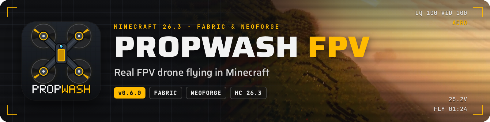

**Echtes FPV-Fliegen in Minecraft.** Bau dir einen Quadcopter aus realen Bauteilen, setz die Brille auf und flieg ihn
in der Ich-Perspektive der Drohne, mit deiner eigenen Funke, einem Gamepad oder der Tastatur. Jag durch Renn-Gates,
flieg Freestyle über deine Bauwerke oder erkunde die Welt aus der Luft.

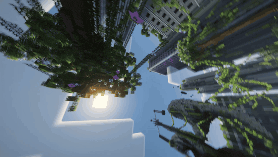

Propwash hat ein eigenes Flugmodell und einen Flight-Controller im Betaflight-Stil, deshalb fliegen sich die Drohnen
wie echte: bissige 5″-Freestyler, verspielte Whoops, sparsame Long-Range-Kreuzer. Alles ist im Überlebensmodus
spielbar, und eine animierte Flugschule erklärt dir die ganze Mod direkt im Spiel.

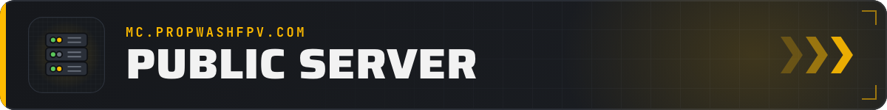

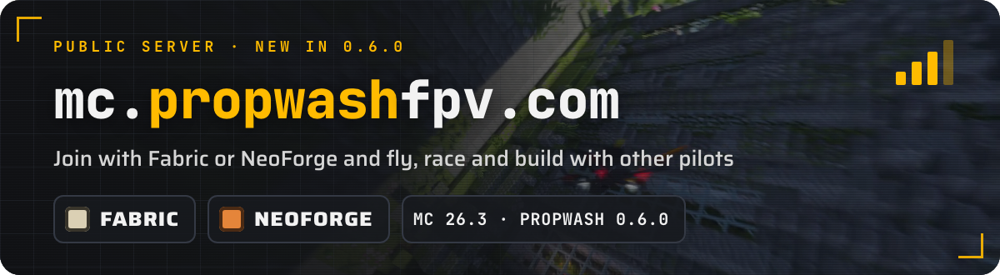

Flieg mit anderen Piloten auf unserem öffentlichen Server **`mc.propwashfpv.com`**. Neu in 0.6.0: Du trittst mit
**Fabric oder NeoForge** bei. NeoForge-Spieler treten einem Fabric-Server bei, auf dem dieselbe Propwash-Version und
dieselben Add-ons laufen. Installier Propwash 0.6.0 und trag die Adresse in deine Serverliste ein; fehlt etwas, nennt
die Beitrittsmeldung die Mods.

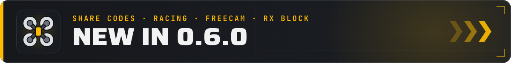

- **Sharecodes für alle Add-ons.** PW3-Codes kommen aus der Werkbank, dem Tab *Sharecode* oder von `/propwash code`. Sie nennen jedes Add-on, das ein Bauplan braucht, zeigen im Überlebensmodus eine Einkaufsliste und sind im Chat klickbar, mit Vorschau der Drohne.
- **Ein größeres Rennsystem.** Schleifen und Durchgänge rückwärts, Punkt-zu-Punkt-Kurse, Gates, die zu Reihen und Tauchwürfeln einrasten, eine Seite *Position*, Kurs-IDs und ein Rennstandard für Server.
- **Zu jedem Rekord ein Replay.** Ein Klick auf eine Zeit in der Bestenliste zeigt den Sharecode der Drohne, ein Replay aus der Ich-Sicht und einen Geist zum Gegenfliegen.
- **Freecam-Drohne.** Eine Kamera-Drohne, die es nur auf deinem Bildschirm gibt: keine Kollision, kein Akku, mitten durch Wände (`F6`, wenn die Welt es erlaubt).
- **RX-Block.** Binde ihn an deine Funke, und ein Kanal wird zum Redstone-Signal von 0 bis 15, bis 128 Blöcke weit.
- **Motor-Hitze wie bei echten Koptern.** Der ESC regelt ab, wenn er überhitzt, heiße Motoren verlieren Leistung und verschleißen.
- **Sauber gesteckte Akkus.** Ein eingesteckter Akku sitzt ohne Stecker und Kabel auf der Drohne, an jedem Rahmen.
- **Drohnen reagieren auf Blöcke.** Slime federt sie zurück, Wolle und Heuballen fangen sie ab, Honig bremst und klebt, Druckplatten und Stolperdrähte lösen aus.
- **Zonen für alle.** Jeder Spieler markiert Zonen mit dem Zonen-Markierer; Kreativ-Barrieren lassen nur Drohnen durch oder halten nur Drohnen auf.
- **Add-on-API 1.8.** Add-ons bringen Schalter, OSD-Anzeigen, Welt-Regeln, werfendes Zubehör, autonome Flüge und einen zweiten Piloten an der Kamera.

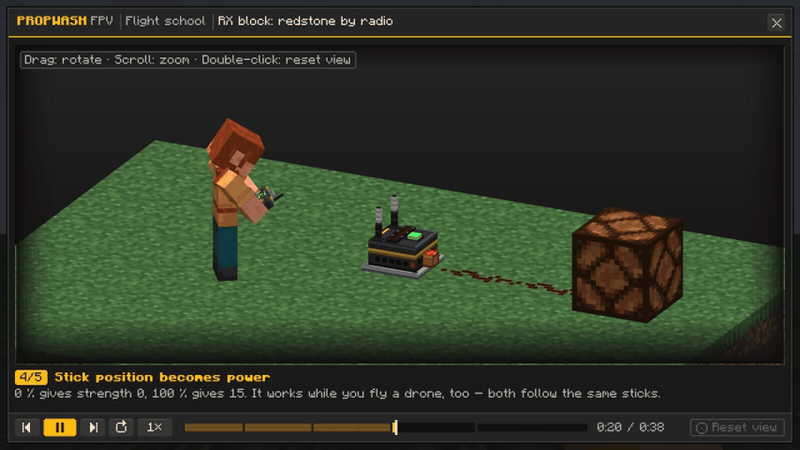

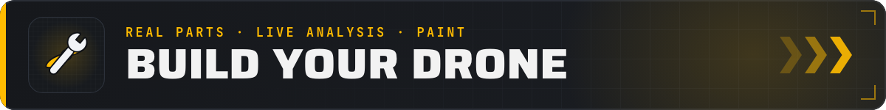

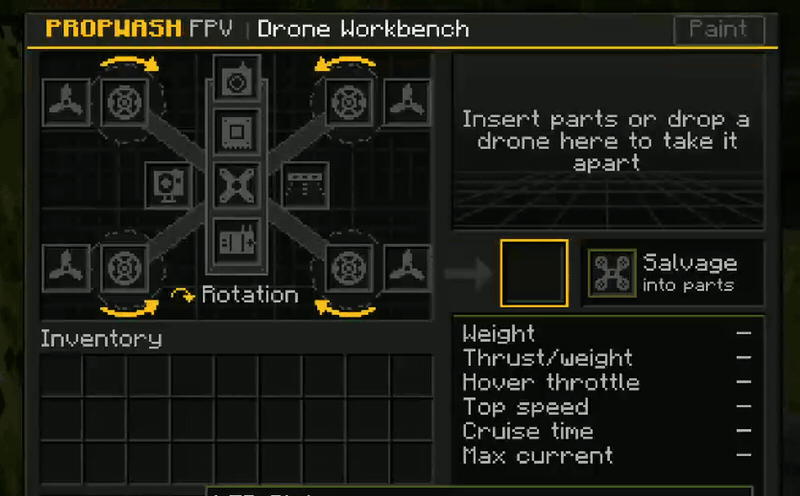

- **Echte Teile, echte Zahlen.** Fünf Rahmen vom 65-mm-Whoop bis zum 7″-Long-Range, dazu Flight-Controller, Motoren, Props, Akkus und Video-Einheiten mit echten Kennzahlen. Gewicht, Schub, Schwebegas, Höchstgeschwindigkeit und Flugzeit ergeben sich aus dem Aufbau.
- **Drohnen-Werkbank.** 3D-Vorschau mit Schub-Gewicht-Verhältnis, Höchstgeschwindigkeit und Flugzeit und einer Warnung für jedes Teil, das nicht passt. Fünf flugfertige Presets im Kreativmodus.
- **Lackierung.** Zwölf Teile einzeln färben, mit Farbstoffen, Oberflächen aus Carbon und Metall, Hex-Farben und Vorlagen.
- **Abstürze hinterlassen Spuren.** Props splittern zuerst, ein harter Einschlag bläht den Akku auf. Props tauschst du im Feld, repariert wird paarweise.

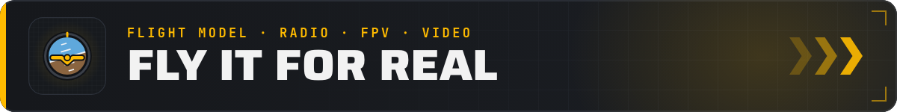

- **Ein echtes Flugmodell.** Starrkörper-Physik mit Motor-, ESC- und Akku-Simulation, Prop-Wash, Bodeneffekt, Wind und Böen. Betaflight- und Actual-Rates, PIDs, Acro, Angle und Horizon, 3D-Modus und GPS Rescue.
- **Deine eigene Funke.** EdgeTX/OpenTX über USB, Gamepads oder die Tastatur. Ein animierter Empfänger-Assistent richtet sie ein, Knüppel-Mode 1 bis 4, jeder Schalter belegbar.
- **FPV oder auf Sicht.** Mit passender Brille siehst du durch die Kamera der Drohne, mit OSD im Betaflight-Stil (über 40 Elemente, Editor mit Drag and Drop). Ohne Brille fliegst du auf Sicht.
- **Analoges und digitales Video.** Analog zerfällt in Stufen zu Schnee und Rauschen, digital wird klötzchenhaft und friert ein. Wände dämpfen die Verbindung, Hügel, Höhlen und tiefes Wasser trennen sie.

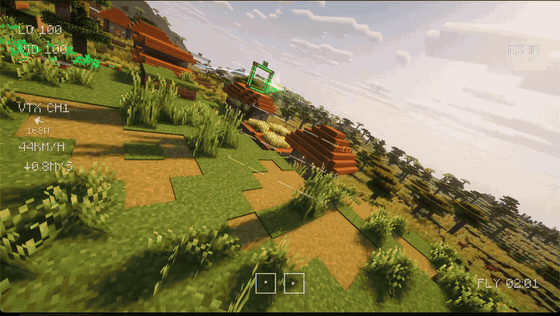

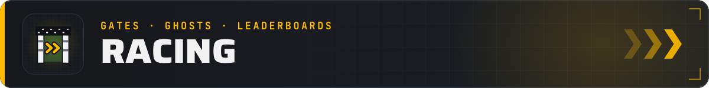

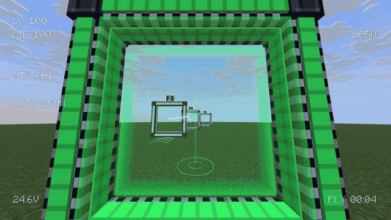

- **Bau deine Strecke.** Gates in drei Größen, gestapelte Leitern, Gate-Stangen, Flaggen, Slalom und Tauchwürfel, freie Gates um jede Öffnung, frei gedreht in Schritten von 45°, 15° oder 5°.
- **Echte Rennzeitnahme.** Zwischenzeiten an jedem Gate, stehende Starts mit Startampel für mehrere Piloten, eine leuchtende Ideallinie durch die nächsten Gates.
- **Geister, Replays, Bestenlisten.** Flieg gegen deine Bestzeit oder den Server-Rekord je Kurs und Drohnenklasse. Es zählen nur Runden, die der Server geprüft hat.

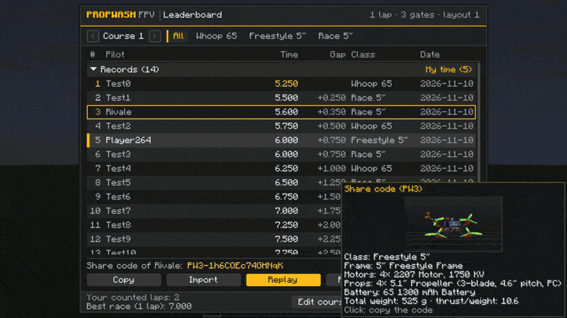

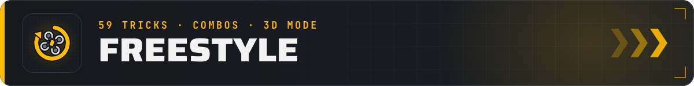

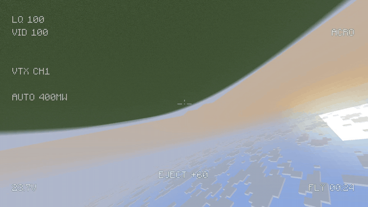

**59 Tricks in neun Familien** werden erkannt, auch unsauber, schnell oder aneinandergereiht: Flips und Rolls, Power
Loops, Juicy Flicks, Matty Flips, Sbang-Kombos, Guillotines, Side Trippies und im 3D-Modus Rückenflug und Tic-Tocs.
Punkte, Kombos bis ×4 und Stil-Boni erscheinen im OSD, und der Tab *Freestyle* erklärt jeden Trick mit einem Video.

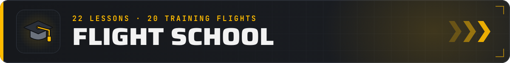

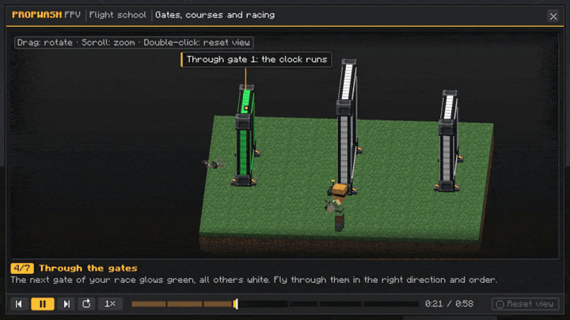

**22 animierte 3D-Lektionen** erklären alles mit einem kleinen Diorama, Beschriftungen und deinen eigenen Tasten:
Bauen, Binden, FPV, Rennen, Tricks, Videosysteme, GPS Rescue und mehr. Das **Flugtraining** bringt 20 Lektionen zum
Selberfliegen durch einen Hologramm-Kurs, mit Sternen, Bestzeiten und Zwischenzeiten. Halte **M** über ein
Propwash-Item, um seine Lektion zu öffnen.

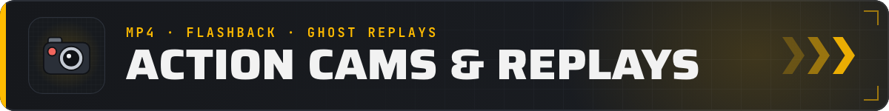

- **Action-Cams, die wirklich aufnehmen.** Montier eine auf den Rahmen und nimm deinen Flug als MP4 auf (H.264, bis 1440p60, auf Wunsch mit Motorgeräusch). Die *Action-Cam (Flashback)* macht aus jedem Flug einen Kamerapfad für die Replay-Mod Flashback.
- **Freecam-Drohne.** Kurse planen und Kamerafahrten filmen, ohne eine echte Drohne zu riskieren.
- **LED-Streifen und Scheinwerfer.** 11 Farben, Modi wie in Betaflight und ein Scheinwerfer, der Höhlen im FPV fliegbar macht; LambDynamicLights wird optional unterstützt.

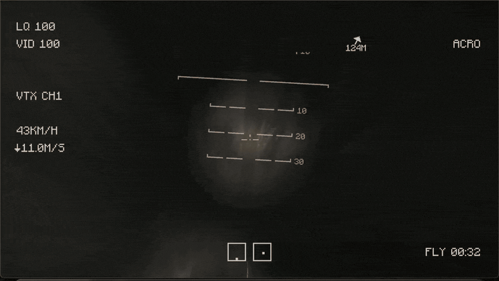

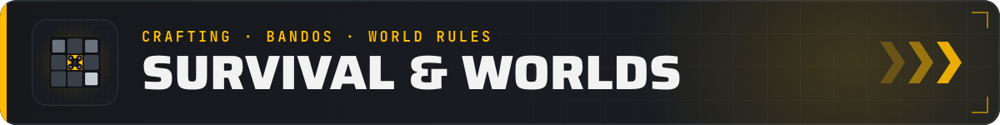

- **Fortschritt im Überlebensmodus.** Alles außer der Kreativ-Brille ist herstellbar: ein ganzer Whoop aus Kupfer, Eisen und Redstone, High-End-Teile mit Diamanten, Amethyst und Echoscherben. Teile liegen auch in Truhen.
- **Orte zum Fliegen.** Seltene Bandos (Scheunen, Fabriken, Wassertürme, Stege, Fördertürme) und vier Arten fertiger Rennkurse entstehen in der Welt.
- **Welt-Regeln.** Schwerkraft, Akkulaufzeit, Wind, Crash-Schaden, Reichweite und mehr als Spielregeln, mit den Voreinstellungen *Realistisch*, *Training* und *Arcade* per Klick.
- **Für Mehrspieler gemacht.** Der Server lädt die Chunks um die Drohne, prüft die Bewegung und hält die Bestenlisten ehrlich.

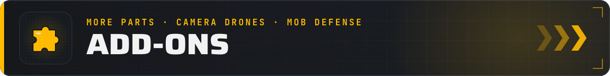

Offizielle Add-ons für Propwash 0.6.0. Installier sie auf dem Client **und** dem Server, in derselben Version.

<table><tr><td width="33%"><a href="https://modrinth.com/mod/propwash-just-more-parts">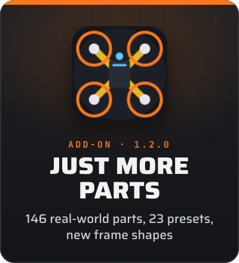</a></td><td width="33%"><a href="https://www.curseforge.com/minecraft/mc-mods/propwash-camera-drones">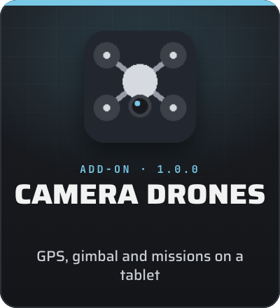</a></td><td width="33%"><a href="https://www.curseforge.com/minecraft/mc-mods/propwash-mob-defense">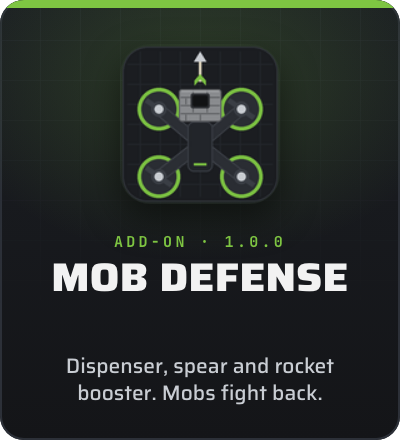</a></td></tr></table>

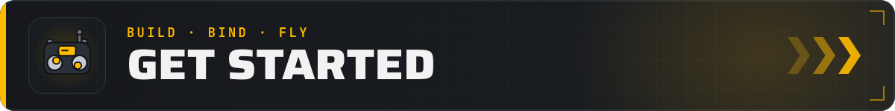

1. Bau eine Drohne an der **Drohnen-Werkbank** oder nimm ein Preset aus dem Kreativ-Tab.
2. Stell sie auf den Boden und klick sie mit der **FPV-Funke** an, um sie zu binden.
3. Setz eine **FPV-Brille** auf, die zum Videosystem der Drohne passt (analog oder digital).
4. Halte die Funke, klick in die Luft, schalte mit deinem Schalter oder **Z** scharf und flieg los.

Hängst du fest? Halte **M** über ein Propwash-Item für seine Flugschul-Lektion oder **Shift** für einen ausführlichen
Tooltip. Die ganze Doku: [propwashfpv.com/docs](https://propwashfpv.com/docs/).

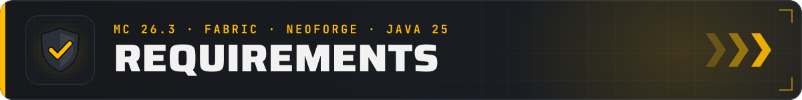

- Minecraft **26.3** · Java 25
- **Fabric:** Fabric Loader 0.19.5+ und Fabric API · **NeoForge:** 26.3.0.10-beta oder neuer
- Nötig auf **Client und Server**
- Mit *Just More Parts*: **1.2.0** oder neuer (1.1.x startet nicht mit Propwash 0.6.0)
- Optional: [LambDynamicLights](https://modrinth.com/mod/lambdynamiclights) für LED-Streifen als echte Lichtquellen
- Funken im USB-Joystick-Modus. Mit einem Shaderpack fällt der Video-Effekt auf ein einfacheres Overlay zurück.

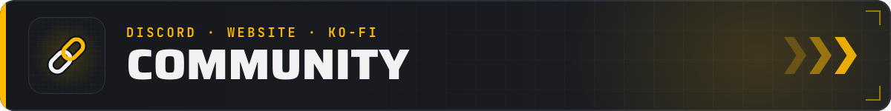

 [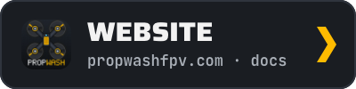](https://propwashfpv.com) 

Fragen, Builds, Rundenzeiten? Komm auf den Discord oder lies die Doku auf der Website. Propwash und seine Add-ons sind
kostenlos; wenn sie dir gefallen, kannst du das Projekt auf [Ko-fi](https://ko-fi.com/propwashfpv) unterstützen. Danke!

*Propwash FPV ist eine eigenständige Mod. Sie steht in keiner Verbindung zu Betaflight, EdgeTX, OpenTX oder einem
Drohnenhersteller.*
*KEIN OFFIZIELLES MINECRAFT-PRODUKT. NICHT VON MOJANG ODER MICROSOFT GENEHMIGT ODER MIT IHNEN VERBUNDEN.*
